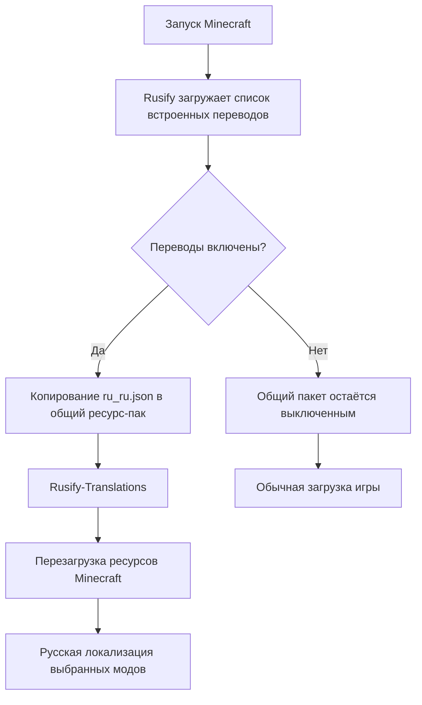

<div align="center">

# Rusify

### Русская локализация Minecraft-модов — в одном удобном месте

**Rusify** — клиентский мод для управления встроенными русскими переводами, поиска непереведённых модов и экспорта языковых файлов. Переводы подключаются как единый динамический ресурс-пак и работают полностью офлайн.

[](https://www.minecraft.net/)
[](https://neoforged.net/)
[](https://adoptium.net/)
[](LICENSE)
[](https://github.com/MAKAKAIglitch/Rusify/actions)
[](https://github.com/MAKAKAIglitch/Rusify/stargazers)

[**GitHub**](https://github.com/MAKAKAIglitch/Rusify) · [**Modrinth**](https://modrinth.com/mod/rusify) · [**Сообщить об ошибке**](https://github.com/MAKAKAIglitch/Rusify/issues) · [**История изменений**](https://github.com/MAKAKAIglitch/Rusify/commits/main)

</div>

---

> [!IMPORTANT]
> **Поддерживаемая конфигурация:** Minecraft **1.21.1**, **NeoForge 21.1.x**, **Java 21**. Rusify работает на клиенте; для использования встроенных переводов не требуется установка на сервер.

## Содержание

- [Возможности](#возможности)
- [Как это работает](#как-это-работает)
- [Встроенные локализации](#встроенные-локализации)
- [Установка](#установка)
- [Использование](#использование)
- [Экспорт переводов других модов](#экспорт-переводов-других-модов)
- [Сборка из исходников](#сборка-из-исходников)
- [Участие в разработке](#участие-в-разработке)
- [Лицензия](#лицензия)

## Возможности

<table>
<tr>
<td width="50%" valign="top">

### Переводы под контролем

- **74 встроенные локализации** для популярных модов.
- Независимое включение и отключение каждого перевода.
- Изменения применяются после перезагрузки ресурсов.
- Все переводы доступны офлайн — сетевые сервисы не нужны.

</td>
<td width="50%" valign="top">

### Умный экспорт

- Сканирование JAR-файлов в папке `mods`.
- Анализ английских и русских языковых файлов.
- Просмотр покрытия перевода и информации о моде.
- Экспорт выбранного мода или всех неполных переводов.

</td>
</tr>
<tr>
<td width="50%" valign="top">

### Чистая структура

- Один общий ресурс-пак `Rusify-Translations`.
- Автоматическое обновление файлов при переключении переводов.
- Удаление только собственных устаревших пакетов Rusify.
- Исходные JAR-файлы модов остаются нетронутыми.

</td>
<td width="50%" valign="top">

### Удобство

- Быстрый вызов клавишей `O`.
- Команда `/rusify`.
- Отдельный экран настроек через список модов.
- Встроенная информация о найденных модах.

</td>
</tr>
</table>

## Как это работает

Rusify не переписывает файлы модов и не подменяет их JAR-архивы. Он собирает выбранные переводы в один ресурс-пак Minecraft.



Структура динамического пакета:

```text
resourcepacks/
└── Rusify-Translations/
    ├── pack.mcmeta
    ├── .rusify-pack
    └── assets/
        ├── create/
        │   └── lang/ru_ru.json
        ├── dungeons_arise/
        │   └── lang/ru_ru.json
        └── ...
```

При отключении перевода удаляется только его языковой файл. Если не осталось ни одного активного перевода, Rusify деактивирует и удаляет принадлежащий ему общий пакет.

## Встроенные локализации

<details open>
<summary><strong>Все 74 локализации · 9 903 переводимых ключа</strong></summary>

Список сформирован по фактическим JSON-файлам в репозитории и сверён с реестром встроенных переводов Rusify. Число ключей указано для текущего файла локализации; оно не означает, что в каждой версии соответствующего мода набор ключей остаётся неизменным.

| Мод | Ключей | Namespace / файл |
|---|---:|---|
| Advanced Loot Info | 609 | [ali](src/main/resources/data/rusify/translations/ali/ru_ru.json) |
| AdvancedCoreInfo | 67 | [aci](src/main/resources/data/rusify/translations/aci/ru_ru.json) |
| Artifacts | 448 | [artifacts](src/main/resources/data/rusify/translations/artifacts/ru_ru.json) |
| uku's Armor Hud | 33 | [armorhud](src/main/resources/data/rusify/translations/armorhud/ru_ru.json) |
| Balm | 36 | [balm](src/main/resources/data/rusify/translations/balm/ru_ru.json) |
| Better Advanced Tooltips | 5 | [betteradvancedtooltips](src/main/resources/data/rusify/translations/betteradvancedtooltips/ru_ru.json) |
| Better Advancements | 1 | [betteradvancements](src/main/resources/data/rusify/translations/betteradvancements/ru_ru.json) |
| Better Biome ReBlend | 9 | [betterbiomereblend](src/main/resources/data/rusify/translations/betterbiomereblend/ru_ru.json) |
| YUNG's Better End Island | 13 | [betterendisland](src/main/resources/data/rusify/translations/betterendisland/ru_ru.json) |
| Better Third Person | 8 | [betterthirdperson](src/main/resources/data/rusify/translations/betterthirdperson/ru_ru.json) |
| Better Zoom | 30 | [betterzoom](src/main/resources/data/rusify/translations/betterzoom/ru_ru.json) |
| Borderless Window | 21 | [borderless](src/main/resources/data/rusify/translations/borderless/ru_ru.json) |
| BreakingPlace 211 neo | 3 | [breakingplace211neo](src/main/resources/data/rusify/translations/breakingplace211neo/ru_ru.json) |
| Carry On | 12 | [carryon](src/main/resources/data/rusify/translations/carryon/ru_ru.json) |
| Chat Heads | 30 | [chat_heads](src/main/resources/data/rusify/translations/chat_heads/ru_ru.json) |
| Chef's Delight | 15 | [chefsdelight](src/main/resources/data/rusify/translations/chefsdelight/ru_ru.json) |
| Chunk Loaders | 30 | [chunkloaders](src/main/resources/data/rusify/translations/chunkloaders/ru_ru.json) |
| Citadel | 24 | [citadel](src/main/resources/data/rusify/translations/citadel/ru_ru.json) |
| Copper Equipment | 37 | [copperequipment](src/main/resources/data/rusify/translations/copperequipment/ru_ru.json) |
| Create: Deep Dark | 51 | [create_deep_dark](src/main/resources/data/rusify/translations/create_deep_dark/ru_ru.json) |
| Create: Hypertubes | 64 | [create_hypertube](src/main/resources/data/rusify/translations/create_hypertube/ru_ru.json) |
| Create: More Automation | 3 | [create_more_automation](src/main/resources/data/rusify/translations/create_more_automation/ru_ru.json) |
| Create: Optical | 169 | [create_optical](src/main/resources/data/rusify/translations/create_optical/ru_ru.json) |
| Create: Train Parts | 71 | [create_train_parts](src/main/resources/data/rusify/translations/create_train_parts/ru_ru.json) |
| Create: Trimmed | 4 | [create_trimmed](src/main/resources/data/rusify/translations/create_trimmed/ru_ru.json) |
| Create: Unified Fuels | 1 | [create_unified_fuels](src/main/resources/data/rusify/translations/create_unified_fuels/ru_ru.json) |
| Create Crafts & Additions | 297 | [createaddition](src/main/resources/data/rusify/translations/createaddition/ru_ru.json) |
| Create Nuclear | 438 | [createnuclear](src/main/resources/data/rusify/translations/createnuclear/ru_ru.json) |
| Cruor | 5 | [cruor](src/main/resources/data/rusify/translations/cruor/ru_ru.json) |
| Curios | 48 | [curios](src/main/resources/data/rusify/translations/curios/ru_ru.json) |
| Curios for Ammo Box | 1 | [curios_for_ammo_box](src/main/resources/data/rusify/translations/curios_for_ammo_box/ru_ru.json) |
| Distant Horizons | 490 | [distanthorizons](src/main/resources/data/rusify/translations/distanthorizons/ru_ru.json) |
| Dynamic FPS | 86 | [dynamic_fps](src/main/resources/data/rusify/translations/dynamic_fps/ru_ru.json) |
| When Dungeons Arise | 119 | [dungeons_arise](src/main/resources/data/rusify/translations/dungeons_arise/ru_ru.json) |
| Every Compat | 1 180 | [everycomp](src/main/resources/data/rusify/translations/everycomp/ru_ru.json) |
| Expanded Delight | 119 | [expandeddelight](src/main/resources/data/rusify/translations/expandeddelight/ru_ru.json) |
| [Let's Do] Farm & Charm | 681 | [farm_and_charm](src/main/resources/data/rusify/translations/farm_and_charm/ru_ru.json) |
| FastQuit | 26 | [fastquit](src/main/resources/data/rusify/translations/fastquit/ru_ru.json) |
| Guard Villagers | 74 | [guardvillagers](src/main/resources/data/rusify/translations/guardvillagers/ru_ru.json) |
| Friends & Foes | 281 | [friendsandfoes](src/main/resources/data/rusify/translations/friendsandfoes/ru_ru.json) |
| [Let's Do] Furniture | 393 | [furniture](src/main/resources/data/rusify/translations/furniture/ru_ru.json) |
| Gems Realm | 304 | [gemsrealm](src/main/resources/data/rusify/translations/gemsrealm/ru_ru.json) |
| Golem Overhaul | 59 | [golemoverhaul](src/main/resources/data/rusify/translations/golemoverhaul/ru_ru.json) |
| Held Item Info | 56 | [held_item_info](src/main/resources/data/rusify/translations/held_item_info/ru_ru.json) |
| iChunUtil | 38 | [ichunutil](src/main/resources/data/rusify/translations/ichunutil/ru_ru.json) |
| Just Enough Items (JEI) | 618 | [jei](src/main/resources/data/rusify/translations/jei/ru_ru.json) |
| Jump Over Fences | 3 | [jumpoverfences](src/main/resources/data/rusify/translations/jumpoverfences/ru_ru.json) |
| LambDynamicLights | 65 | [lambdynlights](src/main/resources/data/rusify/translations/lambdynlights/ru_ru.json) |
| Kiwi Library | 75 | [kiwi](src/main/resources/data/rusify/translations/kiwi/ru_ru.json) |
| L_Ender's Delight | 86 | [lendersdelight](src/main/resources/data/rusify/translations/lendersdelight/ru_ru.json) |
| Lift n' Load | 14 | [create_lnl](src/main/resources/data/rusify/translations/create_lnl/ru_ru.json) |
| ModernFix | 155 | [modernfix](src/main/resources/data/rusify/translations/modernfix/ru_ru.json) |
| More Culling | 56 | [moreculling](src/main/resources/data/rusify/translations/moreculling/ru_ru.json) |
| More Delight | 58 | [moredelight](src/main/resources/data/rusify/translations/moredelight/ru_ru.json) |
| OfflineLAN | 2 | [offlinelan](src/main/resources/data/rusify/translations/offlinelan/ru_ru.json) |
| Ping Wheel | 61 | [pingwheel](src/main/resources/data/rusify/translations/pingwheel/ru_ru.json) |
| Pufferfish's Skills | 50 | [puffish_skills](src/main/resources/data/rusify/translations/puffish_skills/ru_ru.json) |
| Punchy! | 275 | [punchy](src/main/resources/data/rusify/translations/punchy/ru_ru.json) |
| Ragdoll Corpse | 6 | [ragdoll_corpse](src/main/resources/data/rusify/translations/ragdoll_corpse/ru_ru.json) |
| Ragdoll Reactions | 75 | [ragdoll_reactions](src/main/resources/data/rusify/translations/ragdoll_reactions/ru_ru.json) |
| RebindNarrator | 1 | [rebindnarrator](src/main/resources/data/rusify/translations/rebindnarrator/ru_ru.json) |
| Resourceful Config | 28 | [resourcefulconfig](src/main/resources/data/rusify/translations/resourcefulconfig/ru_ru.json) |
| Sable | 128 | [sable](src/main/resources/data/rusify/translations/sable/ru_ru.json) |
| Sable: Physics Compat | 10 | [sablephysicscompat](src/main/resources/data/rusify/translations/sablephysicscompat/ru_ru.json) |
| Sable Ragdolls | 43 | [sable_player_ragdoll](src/main/resources/data/rusify/translations/sable_player_ragdoll/ru_ru.json) |
| Screenshot Viewer | 74 | [screenshot_viewer](src/main/resources/data/rusify/translations/screenshot_viewer/ru_ru.json) |
| Snow! Real Magic! | 74 | [snowrealmagic](src/main/resources/data/rusify/translations/snowrealmagic/ru_ru.json) |
| Sodium Extra | 418 | [sodium_extra](src/main/resources/data/rusify/translations/sodium_extra/ru_ru.json) |
| Stone Zone | 411 | [stonezone](src/main/resources/data/rusify/translations/stonezone/ru_ru.json) |
| Tectonic | 109 | [tectonic](src/main/resources/data/rusify/translations/tectonic/ru_ru.json) |
| Trimmed | 2 | [trimmed](src/main/resources/data/rusify/translations/trimmed/ru_ru.json) |
| Ukulib | 14 | [ukulib](src/main/resources/data/rusify/translations/ukulib/ru_ru.json) |
| [Let's Do] Vinery | 500 | [vinery](src/main/resources/data/rusify/translations/vinery/ru_ru.json) |
| YUNG's API | 3 | [yungsapi](src/main/resources/data/rusify/translations/yungsapi/ru_ru.json) |

</details>

## Установка

1. Установите **Minecraft 1.21.1** с загрузчиком **NeoForge 21.1.x**.
2. Убедитесь, что используется **Java 21**.
3. Скачайте актуальный JAR Rusify со страницы [Modrinth](https://modrinth.com/mod/rusify) или из раздела [Releases](https://github.com/MAKAKAIglitch/Rusify/releases).
4. Поместите JAR в папку `mods` вашего экземпляра игры.
5. Запустите Minecraft и откройте меню Rusify.

> [!TIP]
> Если вы используете Prism Launcher, скачивайте файл для нужного экземпляра и кладите его именно в его папку `mods`.

## Использование

### Управление встроенными переводами

Откройте меню одним из способов:

- Нажмите **`O`** (клавиша по умолчанию; её можно переназначить в настройках управления).
- Введите команду **`/rusify`**.
- Откройте настройки Rusify через список установленных модов.

Во вкладке **«Переводы и настройки»** включайте и отключайте нужные локализации. После изменения списка перезагрузите ресурсы, если игра не применила их автоматически.

### Общий ресурс-пак

В списке наборов ресурсов отображается один пакет — **Rusify-Translations**. Именно он содержит все выбранные встроенные переводы. Отдельный ресурс-пак для каждого мода не создаётся.

## Экспорт переводов других модов

1. Откройте меню Rusify.
2. Перейдите в **«Переводы и экспорт установленных модов»**.
3. Нажмите **«Сканировать»** — Rusify проверит JAR-файлы в папке `mods`.
4. Выберите мод, чтобы посмотреть информацию и извлечь его языковые файлы, либо нажмите **«Экспорт <100%»**.

Экспортируются моды с неполным покрытием перевода. Результаты сохраняются в:

```text
Rusify/
└── exports/
    ├── Частичный перевод/
    └── Нет перевода/
```

Сканер показывает количество модов со встроенным переводом Rusify, частичной локализацией и без русского перевода. Встроенные переводы Rusify также можно экспортировать отдельно.

## Сборка из исходников

Для Windows предусмотрен сценарий `build.bat`:

```bat
build.bat
```

Сборщик ищет установленный JDK 21, а при его отсутствии скачивает Eclipse Temurin 21 через официальный API Adoptium и проверяет архив по SHA-256. Затем проект собирается через Gradle Wrapper.

Другие полезные команды:

```bat
build.bat clean build
build.bat runClient
```

Готовый JAR появится в `build/libs/`.

Для обновления исходников из GitHub используйте:

```bat
update-sources.bat
```

Скрипт работает как в Git-клоне, так и в папке, распакованной из ZIP. Перед заменой отличающихся файлов он сохраняет резервные копии в `.rusify-backups/` и не затрагивает игровые данные — `mods`, `config`, `saves`, `logs` и локальные кэши.

Подробности: [BUILDING.md](BUILDING.md).

## Участие в разработке

- Нашли ошибку или несовместимость? [Создайте Issue](https://github.com/MAKAKAIglitch/Rusify/issues/new/choose).
- Хотите предложить перевод? Отправьте [Pull Request](https://github.com/MAKAKAIglitch/Rusify/compare).
- Предложения по новым модам и локализациям также можно обсуждать в [Discussions](https://github.com/MAKAKAIglitch/Rusify/discussions), если раздел включён в репозитории.

Структура встроенного перевода:

```text
src/main/resources/data/rusify/translations/<modid>/ru_ru.json
```

При добавлении нового встроенного перевода необходимо зарегистрировать его namespace и имя в `TranslationPackManager.java`. Подробности о процессе локализации и структуре проекта можно вынести в [документацию по конвейеру переводов](docs/TRANSLATION_PIPELINE.md).

## Лицензия

Rusify распространяется под лицензией **MIT**. Подробности — в файле [LICENSE](LICENSE).
